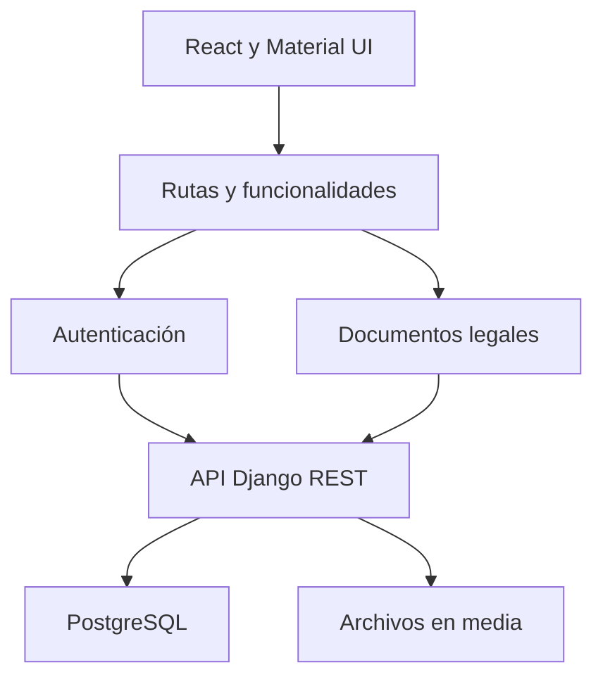
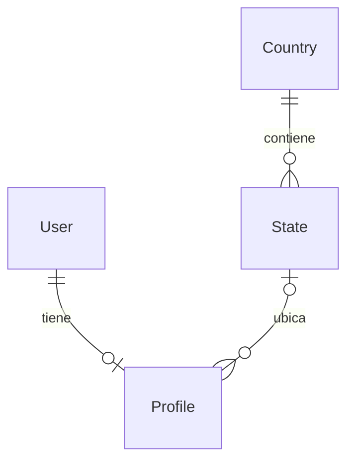
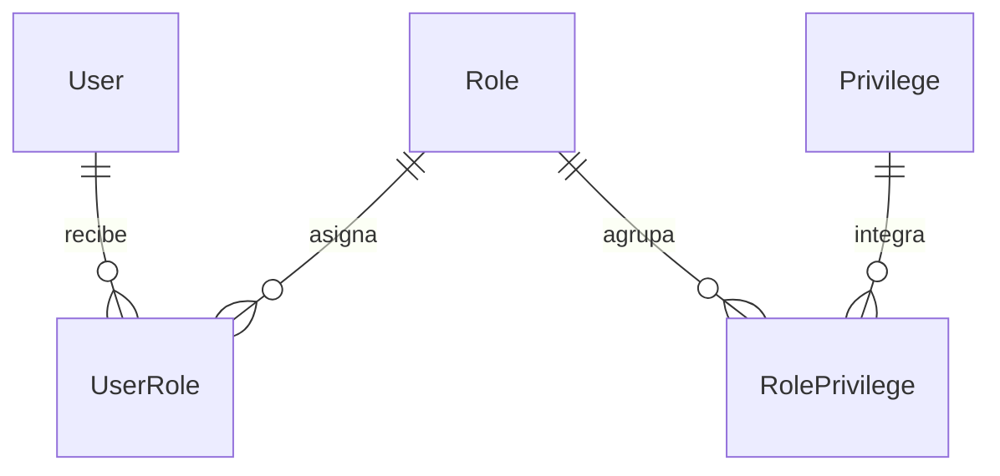
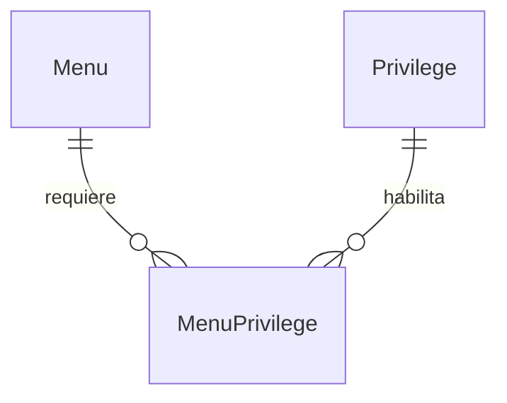
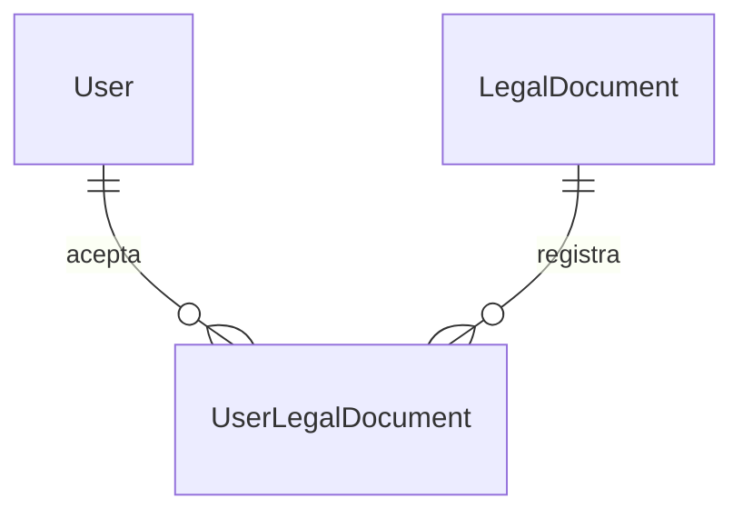

# Arquitectura — Congreso

Versión: 1.0 · Actualización: 28 de octubre de 2026.

Fuente revisada: `congreso_codigo(1).zip`. Ubicación prevista: `docs/ARQUITECTURA.md`. Guía visual complementaria: [ESTILOS.md](ESTILOS.md).

## 1. Alcance y lectura

Este documento explica cómo está organizado el código entregado y dónde agregar nuevas funcionalidades. Los diagramas se reconstruyeron desde los modelos y las relaciones actuales; no son una reproducción del diagrama original del proyecto.

**Actual** significa verificado en el ZIP; **convención propuesta**, una regla para orientar desarrollos futuros; **pendiente**, algo que no aparece implementado en esta copia. El código y las migraciones son la referencia para el estado implementado. Una discrepancia con una regla de negocio debe registrarse y resolverse, sin convertirla silenciosamente en una nueva regla.

Se hizo revisión estática para redactar estos archivos. No se ejecutaron servidores, migraciones, pruebas Django ni build del frontend como parte de esta entrega documental.

## 2. Vista general

El repositorio separa frontend y backend. React consume una API REST; Django administra reglas, autenticación, autorizaciones y persistencia en PostgreSQL. Los archivos subidos se guardan bajo `MEDIA_ROOT` en la configuración actual.



### Dependencias declaradas

| Capa | Declaración en el proyecto | Archivo |
| --- | --- | --- |
| Backend | Django `6.1.1`, DRF `3.18.1`, SimpleJWT `5.5.1` | `backend/requirements.txt` |
| Base de datos | Motor PostgreSQL; psycopg `3.3.6` | `backend/config/settings.py`, `backend/requirements.txt` |
| Frontend | React `^19.2.8`, React Router DOM `^7.18.4` | `frontend/package.json` |
| UI | Material UI `^9.4.0`, iconos `^9.5.0`, Emotion | `frontend/package.json` |
| HTTP | Axios `^1.20.0`; Fetch en registro | `frontend/package.json`, `features/auth/api/registrationApi.js` |
| Herramientas | Vite `^8.3.0`, Oxlint `^1.81.0` | `frontend/package.json` |

Los rangos del frontend no certifican la versión instalada en un equipo. Mantener `package-lock.json` junto con `package.json`; no deducir la versión del servidor PostgreSQL o de Python a partir del ZIP.

## 3. Mapa de carpetas actual

Las rutas de esta tabla parten de la raíz del repositorio.

| Ruta | Responsabilidad |
| --- | --- |
| `backend/config/` | Settings, URL raíz y entradas WSGI/ASGI |
| `backend/users/` | Usuarios, perfil, roles, privilegios, menús y documentos legales |
| `backend/catalogs/` | Países, estados, instituciones, niveles académicos y áreas |
| `backend/users/migrations/` | Evolución de esquema y datos iniciales de users; hasta `0007` en este ZIP |
| `backend/users/management/commands/` | Comandos administrativos; contiene `grant_legal_admin.py` |
| `frontend/src/app/` | Composición global de la aplicación |
| `frontend/src/app/router/` | Registro de rutas React |
| `frontend/src/app/layouts/` | AppLayout, Sidebar y Topbar |
| `frontend/src/features/auth/` | Login, registro, contexto de sesión y protección básica de rutas |
| `frontend/src/features/home/` | Página de inicio |
| `frontend/src/features/legalDocuments/` | Administración de documentos legales |
| `frontend/src/shared/api/` | Cliente Axios común |
| `frontend/public/images/` | Fondos de login y registro |
| `docs/` | Destino de estos dos documentos; agregado por esta entrega |

El entorno virtual y las dependencias instaladas no forman parte de la arquitectura de código fuente.

## 4. Arquitectura del frontend

### Composición y rutas

`main.jsx` monta `CssBaseline`, `AuthProvider` y `App`. `App.jsx` delega en `AppRouter.jsx`, que utiliza `BrowserRouter`.

| Ruta de interfaz | Componente | Acceso actual |
| --- | --- | --- |
| `/login` | `LoginPage` | Público |
| `/registro` | `RegisterPage` | Público |
| `/` | `HomePage` dentro de `AppLayout` | Sesión autenticada |
| `/configuraciones/documentos-legales` | `AdminLegalDocumentsPage` dentro de `AppLayout` | Sesión; la página comprueba `documentos_legales.ver` |

`ProtectedRoute` muestra carga mientras se restaura la sesión y redirige a `/login` si no hay usuario autenticado. No comprueba perfil completo ni privilegios específicos. La página administrativa realiza su propia comprobación; el backend vuelve a autorizar cada operación.

### Responsabilidades por carpeta

| Carpeta | Qué colocar | Qué evitar |
| --- | --- | --- |
| `app/` | Router, layouts, integración de proveedores y futura configuración de tema | Reglas particulares de documentos o evaluaciones |
| `features/<funcionalidad>/pages/` | Pantallas y coordinación de una funcionalidad | Clientes HTTP globales duplicados |
| `features/<funcionalidad>/api/` | Funciones para consumir endpoints del dominio | JSX de presentación |
| `features/<funcionalidad>/components/` | Piezas visuales propias cuando sea útil extraerlas | Componentes generales sin relación con esa funcionalidad |
| `features/<funcionalidad>/hooks/` | Lógica React reutilizable del dominio cuando se necesite | Crear carpetas vacías por anticipación |
| `features/<funcionalidad>/utils/` | Funciones puras del dominio | Acceso implícito a sesión o efectos de red |
| `shared/` | Infraestructura o componentes utilizados por varias funcionalidades | Reglas de negocio particulares |

Las carpetas `hooks/` y componentes adicionales son una convención propuesta para crecer; no todas existen. `auth/context/AuthContext.jsx` es una dependencia transversal real de Home, layout y documentos legales. Una eventual extracción a un proveedor más general debe hacerse como refactor explícito.

`DocumentFormDialog` y varias funciones auxiliares están dentro de `AdminLegalDocumentsPage.jsx`. Es la organización actual; podrán extraerse dentro de esa misma funcionalidad si el tamaño o la reutilización lo justifican.

### Navegación y permisos

`UserSerializer` devuelve `roles`, `privileges`, `menus` y `profile` con los datos del usuario. `Sidebar.jsx` combina Inicio y entradas deshabilitadas con menús enviados por el backend.

- Las rutas que comienzan por `/configuraciones/` se agrupan en Configuraciones.
- Los iconos se resuelven mediante un mapa local (`description`, `settings`) con icono de respaldo.
- Las rutas React deben existir en `AppRouter`; recibir un menú no crea su componente.
- `get_user_menus` entrega menús activos cuando el usuario tiene alguno de los privilegios asociados, ordenados por `order` e `id`.
- Ocultar una acción en React no sustituye la autorización del endpoint.

No se encontró una migración que cree el menú de documentos legales: los privilegios sí se crean en `0007`. La presencia del menú en una base concreta depende de sus registros `Menu` y `MenuPrivilege`.

### Acceso HTTP

`shared/api/apiClient.js` configura Axios a partir de `VITE_API_URL`, con respaldo `http://127.0.0.1:8000/api`. Acepta un origen o un prefijo terminado en `/api`. Las funciones autenticadas agregan expresamente `Authorization: Bearer <access>`.

Registro usa Fetch en `registrationApi.js`, con normalización de URL propia y solicitudes públicas sin credenciales. Los dos caminos coexisten. **Convención propuesta:** ampliar el cliente compartido de forma deliberada y evitar más variantes del cálculo de URL.

Para archivos se envía `FormData`. El cliente no impone `Content-Type: application/json`; Axios y el navegador construyen el encabezado multipart y su boundary.

### Sesión

`AuthContext` almacena access y refresh en `localStorage`, mantiene usuario/access/carga en estado React y consulta `/auth/me/` al restaurar el access. Si esa consulta falla, elimina la sesión local. `logout` elimina ambos tokens y el usuario; la Topbar lo invoca y redirige a `/login`.

Hay endpoint de refresh, pero no existe renovación automática ni interceptor de reintentos en el frontend revisado. El cierre de sesión actual es local; no se encontró revocación de tokens en el servidor.

## 5. Arquitectura del backend

| Archivo de una aplicación | Responsabilidad actual o convención |
| --- | --- |
| `models.py` | Entidades, relaciones, restricciones y reglas vinculadas al modelo |
| `serializers.py` | Contratos de entrada/salida y validación; en users también coordina el registro transaccional |
| `views.py` | Operaciones HTTP, permisos y coordinación; actualmente también publicación/desactivación transaccional |
| `services.py` | Cálculo de privilegios, menús y estado de perfil/legal |
| `permissions.py` | `HasPrivilege` y `HasCompleteProfile` |
| `urls.py` | Rutas de la aplicación |
| `admin.py` | Administración mediante Django Admin |
| `managers.py` | Creación de cuentas y normalización del correo |
| `migrations/` | Cambios versionados del esquema y migraciones de datos |
| `tests.py` | Pruebas del dominio y sus flujos |

La aplicación `catalogs` tiene modelos y administración, pero no una API de catálogos conectada al URL raíz en esta copia. No asumir que crear un modelo publica un endpoint.

**Convención propuesta:** mantener la validación de entrada en serializers, la autorización en permissions y las reglas reutilizables en services/modelos. Al crecer una operación, reducir duplicación sin imponer una capa nueva a cada acción sencilla.

## 6. Modelo de datos comprobado

Los nombres de tabla siguientes son los predeterminados de Django: no se encontraron `db_table` personalizados en estos modelos.

| Modelo | Tabla | Función y relaciones principales |
| --- | --- | --- |
| `User` | `users_user` | Correo único sin username; nombres y apellido materno en esta tabla |
| `Profile` | `users_profile` | Uno a uno con User; estado, institución y nivel académico opcionales hasta completar perfil |
| `UserArea` | `users_userarea` | Relaciona User con Area; par único |
| `Role` | `users_role` | Nombre único, descripción y `is_active` |
| `Privilege` | `users_privilege` | Clave única, nombre y descripción; no tiene `is_active` |
| `UserRole` | `users_userrole` | Relaciona User con Role; par único y fecha de asignación |
| `RolePrivilege` | `users_roleprivilege` | Relaciona Role con Privilege; par único |
| `Menu` | `users_menu` | Nombre, ruta única, icono, orden e indicador activo |
| `MenuPrivilege` | `users_menuprivilege` | Relaciona Menu con Privilege; par único |
| `LegalDocument` | `users_legaldocument` | Tipo, versión, nombre, archivo, publicación y estado activo |
| `UserLegalDocument` | `users_userlegaldocument` | Usuario, documento y fecha de aceptación; par único |
| `Country` | `catalogs_country` | País con nombre único |
| `State` | `catalogs_state` | Estado de un país; nombre único dentro de ese país |
| `AcademicLevel` | `catalogs_academiclevel` | Grado académico y descripción |
| `Institution` | `catalogs_institution` | Institución con nombre único |
| `Area` | `catalogs_area` | Área con clave única y nombre |

El país del perfil se deriva de `state.country_id` y es de solo lectura en la API. No existe un campo `country` independiente en `Profile`. Las especialidades se representan con `UserArea → Area`, aunque su edición no está expuesta por `ProfileSerializer`.

### Perfil y ubicación



Profile también referencia opcionalmente Institution y AcademicLevel, como indica la tabla. El código crea el perfil al registrar; la relación por sí sola no garantiza que cualquier método de creación de User cree un Profile. Django Admin y `/auth/me/` también lo crean cuando corresponde.

### Roles y privilegios



Los privilegios efectivos son la unión sin duplicados de los roles activos de un usuario activo. No existe relación padre/hijo de roles ni herencia jerárquica automática en este modelo.

### Menús y especialidades



Un User puede tener varias Area mediante UserArea y cada Area puede pertenecer a varios usuarios. No duplicar las especialidades como texto libre en Profile.

### Documentos y aceptaciones



`UserLegalDocument` es la trazabilidad versionada implementada. Los booleanos y fechas antiguos de aceptación en User se conservan como histórico; el registro nuevo crea las filas versionadas. No existe un modelo adicional `legal_traceability` ni un campo IP en esta implementación.

## 7. Flujos y reglas implementadas

### Registro

1. El frontend consulta los documentos activos y publicados; requiere exactamente uno de cada tipo esperado con ID y archivo.
2. Captura nombre, apellidos, correo, contraseñas y las dos aceptaciones.
3. Envía IDs de documentos junto con las aceptaciones; normaliza correo y nombres, preservando la contraseña.
4. Django valida correo, contraseñas y consentimiento, y vuelve a comprobar documentos vigentes.
5. Dentro de una transacción crea User, Profile vacío, asignación de rol Ponente y las dos aceptaciones.
6. Si falta un documento, cambió su versión, el rol Ponente está inactivo o falla la operación, no completa el registro.
7. La UI muestra cuenta creada y ofrece iniciar sesión; no inicia sesión automáticamente.

El correo se normaliza a minúsculas y se protege con unicidad sin distinguir mayúsculas. La contraseña se guarda mediante `set_password`.

### Perfil completo y estado legal

El perfil básico requiere `state`, `institution`, `academic_level`, `dialing_code` no vacío y `mobile_phone` no vacío. `Profile.save` recalcula su bandera persistida. La API también calcula el estado efectivo mediante `effective_profile_status`.

| Campo de respuesta | Significado |
| --- | --- |
| `basic_profile_complete` | Están completos los datos básicos requeridos |
| `is_complete` | Igual a la completitud básica; independiente de nuevas aceptaciones |
| `legal_complete` | Existen ambos tipos vigentes y el usuario aceptó esas versiones |
| `pending_legal_document_ids` | IDs vigentes aún no aceptados |
| `unavailable_legal_types` | Tipos requeridos sin documento activo ya publicado |

**Regla vigente:** publicar nuevas versiones legales no vuelve incompleto el perfil ni bloquea acciones que requieran perfil completo. El mecanismo de notificación al usuario sigue pendiente. El registro inicial sí exige las aceptaciones de los documentos vigentes.

`HasCompleteProfile` existe para endpoints que requieran datos completos, pero no se encontró aplicado en las vistas productivas actuales. Tampoco existe todavía la pantalla de completar perfil ni una redirección global hacia ella.

### Administración legal

- Crear guarda un documento inactivo; crear o editar no publica.
- Editar requiere documento inactivo y sin aceptaciones.
- Publicar requiere que la fecha de publicación ya haya llegado; no hay publicación programada automática.
- Publicar desactiva las otras versiones activas del mismo tipo dentro de una transacción. En PostgreSQL emplea además un bloqueo asesor transaccional por tipo.
- La restricción de base de datos permite como máximo una versión activa por tipo y una fila por par tipo/versión.
- Desactivar conserva el documento y su historial; no hay endpoint DELETE en estas rutas.
- El contenido y metadatos protegidos de un documento aceptado no se pueden modificar mediante el guardado validado del modelo.
- La API de aceptación propia deriva el usuario de la sesión; repetir la misma aceptación devuelve la existente.
- La protección de historial también utiliza relaciones `PROTECT`; las aceptaciones no se pueden agregar ni eliminar desde su ModelAdmin.

La UI acepta seleccionar PDF/DOC/DOCX; esa opción del selector no equivale por sí sola a validación de contenido o extensión en el servidor.

## 8. Contratos HTTP actuales

Todas estas rutas incluyen el prefijo `/api/`. Django Admin usa `/admin/`, que es una ruta distinta de `/api/admin/...`.

| Método | Ruta | Acceso / propósito |
| --- | --- | --- |
| POST | `/api/auth/register/` | Público; registra cuenta |
| POST | `/api/auth/login/` | Público; devuelve access, refresh y user |
| POST | `/api/auth/refresh/` | Requiere refresh válido; renueva access |
| GET | `/api/auth/me/` | JWT; devuelve usuario y contexto |
| GET, PATCH | `/api/auth/profile/` | JWT; consulta/actualiza perfil propio |
| GET | `/api/auth/legal-documents/` | Público; documentos activos ya publicados |
| POST | `/api/auth/legal-acceptances/` | JWT; acepta documento vigente para el usuario de la sesión |
| GET | `/api/admin/legal-documents/` | JWT + `documentos_legales.ver` |
| POST | `/api/admin/legal-documents/` | JWT + `documentos_legales.crear`; crea borrador |
| PATCH | `/api/admin/legal-documents/<id>/` | JWT + `documentos_legales.editar` |
| POST | `/api/admin/legal-documents/<id>/publish/` | JWT + `documentos_legales.publicar` |
| POST | `/api/admin/legal-documents/<id>/deactivate/` | JWT + `documentos_legales.desactivar` |
| PATCH | `/api/landing/admin/congress/` | JWT + `diseño_pagina`; actualiza los campos de convocatoria/contacto del congreso vigente |
| PATCH | `/api/landing/admin/page/` | JWT + `diseño_pagina`; actualiza imágenes, enlace del programa y color |
| POST | `/api/landing/admin/dates/` | JWT + `diseño_pagina`; agrega una fecha al congreso vigente |
| PATCH, DELETE | `/api/landing/admin/dates/<id>/` | JWT + `diseño_pagina`; modifica o elimina una fecha asociada al congreso vigente |
| POST | `/api/landing/admin/sponsors/` | JWT + `diseño_pagina`; agrega un patrocinador al congreso vigente |
| PATCH, DELETE | `/api/landing/admin/sponsors/<id>/` | JWT + `diseño_pagina`; modifica o elimina la relación con el congreso vigente |

Las rutas de edición seleccionan el congreso con mayor edición y, como desempate, mayor ID; no reciben `id_congreso` del cliente. Las fechas y patrocinadores se verifican contra esa relación. Si una fecha o patrocinador también pertenece a otro congreso, se separa su registro antes de editar para conservar intactos los datos compartidos. Las imágenes se reciben como multipart, se guardan bajo `MEDIA_ROOT/landing/` y la base almacena su ruta. El formulario debe autenticarse con un usuario que tenga el privilegio `diseño_pagina`.

El alcance de estas rutas se limita a campos que ya tienen tablas: convocatoria, contacto, imágenes/enlace/color de página, fechas y patrocinadores. Los formularios de documentos, videos y publicaciones de la landing no tienen almacenamiento asociado en el esquema actual y no se guardan con estas rutas.

Login devuelve `{ message, access, refresh, user }`; registro devuelve `{ message, user }`. El listado administrativo es un array sin paginación en esta versión. Su serializer añade `is_active` y `has_acceptances` a los datos del documento.

Las vistas administrativas verifican privilegios en el backend. `is_superuser` no otorga automáticamente todos los códigos personalizados a través de `get_user_privilege_codes`.

El comando `python manage.py grant_legal_admin --email correo@ejemplo.com`, ejecutado desde backend, asigna los cinco privilegios legales mediante el rol Administrador global a un superusuario activo existente. Deben existir previamente las migraciones. El comando no crea una cuenta ni un menú y no impone que haya un único administrador global.

## 9. Configuración y archivos

| Configuración | Estado observado |
| --- | --- |
| Variables Django | `SECRET_KEY`, `DB_NAME`, `DB_USER`, `DB_PASSWORD`, `DB_HOST`, `DB_PORT` cargadas desde `backend/.env` |
| Conexión PostgreSQL | Se construye con variables `DB_*`; este settings no lee `DATABASE_URL` |
| Modo y hosts | `DEBUG = True`, `ALLOWED_HOSTS = []` en el código revisado |
| URL de API React | `VITE_API_URL`; valor visible al cliente, no lugar para secretos |
| CORS local | `http://localhost:5173` y `http://127.0.0.1:5173` |
| Zona del backend | `TIME_ZONE = "UTC"`, `USE_TZ = True` |
| JWT | Access 30 minutos; refresh 7 días |
| Media | `MEDIA_ROOT = BASE_DIR / "media"`; `MEDIA_URL = "/media/"` |
| Servicio local de media | Registrado en las URLs cuando DEBUG está activo |

No se incluyeron `.env`, archivos subidos ni base de datos en el ZIP. No documentar valores secretos. El esquema no prueba qué datos, roles, menús o documentos están cargados en una base concreta. No se encontraron archivos de despliegue para describir una arquitectura productiva.

## 10. Cómo agregar una funcionalidad

Convención propuesta para el equipo:

1. Definir operación, contrato de API, privilegio requerido y si necesita perfil completo.
2. Colocar modelos y reglas en la aplicación Django responsable; crear otra app cuando exista un dominio diferenciado, no solo porque haya otra pantalla.
3. Agregar migraciones para cambios de esquema y datos iniciales necesarios.
4. Implementar serializer, vista, permisos y URL; verificar la autorización en backend.
5. Crear `features/<nombre>/pages` y `api` en React; agregar componentes/hooks internos cuando sean necesarios.
6. Registrar el componente en `AppRouter` y, si corresponde, el menú y sus privilegios en backend. Asegurar que los datos iniciales sean reproducibles.
7. Reutilizar sesión y cliente HTTP; no duplicar tokens o URL base en la pantalla.
8. Seguir [ESTILOS.md](ESTILOS.md) y documentar cualquier patrón nuevo.
9. Verificar el flujo y actualizar este documento en el mismo cambio.

Usar nombres descriptivos: componentes/páginas en PascalCase, hooks `use...`, funciones y variables JavaScript en camelCase; módulos y funciones Python en snake_case. Son convenciones propuestas coherentes con los archivos actuales.

## 11. Estado de los desarrollos siguientes

| Tema | Situación en este ZIP |
| --- | --- |
| Perfil obligatorio | Cálculo y permiso disponibles; falta UI y aplicar el permiso a las operaciones futuras correspondientes |
| Especialidades | UserArea existe; falta edición en la API de perfil |
| Documentos legales | Gestión administrativa implementada; falta definir notificación de nuevas versiones |
| Roles y catálogos | Modelos y Django Admin; falta administración completa mediante React/API |
| Administrador global único | Regla acordada; unicidad aún no impuesta por código |
| Jerarquía de roles | Regla discutida; implementación actual combina roles sin jerarquía |
| Trabajos y evaluaciones | No hay modelos, endpoints o pantallas funcionales de estos dominios en la copia |
| Evaluación ordinaria | Regla acordada: dos evaluadores de forma secuencial/intercalada; por implementar |
| Excepción de evaluación | Regla acordada: tres evaluadores en paralelo y evitar autoevaluación; por implementar |
| Calendario | Periodos globales y excepciones acordados; sin implementación en la copia |
| Tema visual común | Pendiente; estilos locales en acceso y tema MUI predeterminado en panel |

Estas reglas pendientes proceden del contexto acordado del proyecto; no deben confundirse con capacidades ya disponibles. Los requisitos futuros de evaluación deben comprobar también especialidad, asignación, conflicto de interés y periodo cuando se construya ese dominio.

## 12. Verificación y mantenimiento

`backend/users/tests.py` contiene pruebas de registro, JWT, perfil, privilegios, migraciones históricas y administración legal, incluida una prueba de que una nueva versión legal no bloquea el perfil. Su presencia no acredita una ejecución exitosa en esta revisión.

Comandos existentes para futuras verificaciones, usando las dependencias y PostgreSQL del entorno de desarrollo:

```bash
# Desde backend, con el entorno virtual activo
python manage.py check
python manage.py test users
```

```bash
# Desde frontend, con las dependencias instaladas
npm run lint
npm run build
```

Actualizar este archivo cuando cambien rutas, carpetas, entidades, permisos, proveedores, configuración o reglas de negocio. Mantener los diagramas editables en Mermaid, corregir la sección afectada y añadir una entrada al historial.

Plantilla para ampliar el documento:

```md
### Nombre de la funcionalidad o decisión

- Estado: Actual / Convención propuesta / Pendiente.
- Problema y comportamiento esperado:
- Frontend: carpetas, página y ruta.
- Backend: aplicación, modelos y endpoints.
- Permisos y requisitos de perfil:
- Datos o migraciones necesarias:
- Relación con otros módulos:
- Verificación realizada y límites:
```

Cuando una tarea pendiente se implemente, mover su descripción a la sección de estado actual. No conservar dos descripciones contradictorias. Para asociar cambios con código, registrar el commit real cuando se conozca; no inventar hashes.

## 13. Historial

| Fecha | Versión | Cambio |
| --- | --- | --- |
| 2026-10-28 | 1.0 | Primera documentación del ZIP actualizado: estructura, entidades, rutas, autenticación, administración legal y reglas de evolución. |
