# Base de datos CONING — esquema actual

Base de datos PostgreSQL `coning`. Tablas generadas a partir de los modelos de Django (55 tablas propias, sin contar las internas de Django como sesiones o permisos).

## Cómo ver las tablas

La base es PostgreSQL, se llama **`coning`** y corre en tu computadora (host `localhost`, puerto `5432`). Los datos de conexión están en `backend/.env` (`DB_NAME`, `DB_USER`, `DB_PASSWORD`, `DB_HOST`, `DB_PORT`).

1. **pgAdmin** (viene con PostgreSQL): Servers → PostgreSQL → Databases → `coning` → Schemas → public → **Tables**. Clic derecho en una tabla → *View/Edit Data → All Rows*. Para ver el diagrama: clic derecho en la base `coning` → *ERD For Database*.
2. **DBeaver** (gratis): nueva conexión PostgreSQL con los mismos datos; después clic derecho en la base → *View Diagram* para ver las relaciones dibujadas.
3. **Terminal**: `psql -U <usuario> -d coning`, y dentro `\dt` (lista de tablas), `\d trabajos_trabajo` (columnas de una tabla), `SELECT * FROM trabajos_trabajo;`.
4. **Desde Django**: `python manage.py dbshell` abre `psql` ya conectado.

Convención: cada tabla se llama `<app>_<modelo>`; por ejemplo `trabajos_evaluador` es el modelo Evaluador de la app `trabajos`. Las columnas de llave foránea terminan en `_id`.

## Tablas más importantes para el flujo de un trabajo

- `trabajos_trabajo`: el trabajo (clave T000001, título, resumen, fase actual). `trabajos_usuariotrabajo` guarda sus autores y coautores.
- `trabajos_fase`: pasos por los que avanza cada tipo de actividad (resumen enviado, en evaluación, extenso aprobado, etc.).
- `trabajos_evaluador`: qué evaluador revisa qué trabajo, en qué **etapa** (resumen o extenso) y **ronda**, con su dictamen. `trabajos_pregunta` y `trabajos_trabajopregunta` guardan las preguntas y sus respuestas.
- `trabajos_trabajodocumento`: el archivo del extenso. Si estaba en Word, el PDF convertido se guarda junto al original en `media/` (no tiene tabla propia).
- `congreso_congreso`: cada edición; trae el máximo de trabajos por evaluador y el límite global por usuario. Las excepciones personales están en `congreso_limiteevaluador` (evaluadores) y `congreso_limiteusuario` (ponentes).
- `users_solicitudrol`: solicitudes de rol (hoy solo evaluador) que resuelve el coordinador.
- `congreso_pago` y `trabajos_autorizacionconstancia`: pagos validados y autorizaciones del coordinador para liberar constancias.

## Diagrama de relaciones

```mermaid
erDiagram
    users_menu ||--o{ users_menuprivilege : "menu_id"
    users_privilege ||--o{ users_menuprivilege : "privilege_id"
    users_user ||--o{ users_profile : "user_id"
    catalogs_state ||--o{ users_profile : "state_id"
    catalogs_institution ||--o{ users_profile : "institution_id"
    catalogs_academiclevel ||--o{ users_profile : "academic_level_id"
    users_role ||--o{ users_roleprivilege : "role_id"
    users_privilege ||--o{ users_roleprivilege : "privilege_id"
    users_user ||--o{ users_solicitudrol : "usuario_id"
    users_role ||--o{ users_solicitudrol : "rol_id"
    users_user ||--o{ users_solicitudrol : "resuelta_por_id"
    users_user ||--o{ users_userarea : "user_id"
    catalogs_area ||--o{ users_userarea : "area_id"
    users_user ||--o{ users_userlegaldocument : "user_id"
    users_legaldocument ||--o{ users_userlegaldocument : "document_id"
    users_user ||--o{ users_userprivilege : "user_id"
    users_privilege ||--o{ users_userprivilege : "privilege_id"
    users_user ||--o{ users_userrole : "user_id"
    users_role ||--o{ users_userrole : "role_id"
    catalogs_institution ||--o{ catalogs_campus : "institution_id"
    catalogs_country ||--o{ catalogs_state : "country_id"
    congreso_edificio ||--o{ congreso_aula : "edificio_id"
    congreso_congreso ||--o{ congreso_congresoactividad : "congreso_id"
    congreso_actividad ||--o{ congreso_congresoactividad : "actividad_id"
    congreso_congreso ||--o{ congreso_congresofechaimportante : "congreso_id"
    congreso_fechaimportante ||--o{ congreso_congresofechaimportante : "fecha_importante_id"
    congreso_congreso ||--o{ congreso_congresopatrocinador : "congreso_id"
    congreso_patrocinador ||--o{ congreso_congresopatrocinador : "patrocinador_id"
    congreso_congreso ||--o{ congreso_cuota : "congreso_id"
    congreso_conceptocuota ||--o{ congreso_cuota : "concepto_id"
    congreso_campuscongreso ||--o{ congreso_edificio : "campus_id"
    users_user ||--o{ congreso_limiteevaluador : "usuario_id"
    congreso_congreso ||--o{ congreso_limiteevaluador : "congreso_id"
    congreso_actividad ||--o{ congreso_limitetrabajo : "actividad_id"
    users_user ||--o{ congreso_limiteusuario : "usuario_id"
    congreso_limitetrabajo ||--o{ congreso_limiteusuario : "limite_id"
    congreso_congreso ||--o{ congreso_pagina : "congreso_id"
    congreso_cuota ||--o{ congreso_pago : "cuota_id"
    users_user ||--o{ congreso_pago : "usuario_id"
    users_user ||--o{ congreso_pago : "revisado_por_id"
    congreso_tipopatrocinador ||--o{ congreso_patrocinador : "tipo_id"
    users_user ||--o{ congreso_usuariocomite : "usuario_id"
    congreso_comite ||--o{ congreso_usuariocomite : "comite_id"
    users_user ||--o{ trabajos_asistencia : "usuario_id"
    congreso_congreso ||--o{ trabajos_asistencia : "congreso_id"
    trabajos_trabajo ||--o{ trabajos_asistencia : "trabajo_id"
    users_user ||--o{ trabajos_autorizacionconstancia : "usuario_id"
    trabajos_trabajo ||--o{ trabajos_autorizacionconstancia : "trabajo_id"
    users_user ||--o{ trabajos_autorizacionconstancia : "autorizada_por_id"
    users_user ||--o{ trabajos_evaluador : "usuario_id"
    trabajos_trabajo ||--o{ trabajos_evaluador : "trabajo_id"
    congreso_actividad ||--o{ trabajos_fase : "actividad_id"
    congreso_aula ||--o{ trabajos_horario : "aula_id"
    trabajos_trabajo ||--o{ trabajos_horario : "trabajo_id"
    trabajos_fase ||--o{ trabajos_pregunta : "fase_id"
    congreso_congreso ||--o{ trabajos_trabajo : "congreso_id"
    congreso_actividad ||--o{ trabajos_trabajo : "actividad_id"
    catalogs_area ||--o{ trabajos_trabajo : "area_id"
    trabajos_fase ||--o{ trabajos_trabajo : "fase_id"
    trabajos_trabajo ||--o{ trabajos_trabajodocumento : "trabajo_id"
    trabajos_documento ||--o{ trabajos_trabajodocumento : "documento_id"
    trabajos_trabajo ||--o{ trabajos_trabajopregunta : "trabajo_id"
    trabajos_pregunta ||--o{ trabajos_trabajopregunta : "pregunta_id"
    trabajos_evaluador ||--o{ trabajos_trabajopregunta : "evaluador_id"
    users_user ||--o{ trabajos_usuariotrabajo : "usuario_id"
    trabajos_trabajo ||--o{ trabajos_usuariotrabajo : "trabajo_id"
    soporte_categoriaticket ||--o{ soporte_ticket : "categoria_id"
    soporte_ticket ||--o{ soporte_ticketusuario : "ticket_id"
    users_user ||--o{ soporte_ticketusuario : "usuario_id"
```

## Usuarios, roles y privilegios (`users`)

### `users_legaldocument`
| Columna | Tipo | Notas |
|---|---|---|
| `id` | BigAutoField | PK |
| `type` | CharField(30) |  |
| `version` | CharField(50) |  |
| `name` | CharField(255) |  |
| `file` | FileField(100) |  |
| `published_at` | DateTimeField |  |
| `is_active` | BooleanField | por defecto: False |

_Restricción única:_ (type, version)

_Restricción única:_ (type)

### `users_menu`
| Columna | Tipo | Notas |
|---|---|---|
| `id` | BigAutoField | PK |
| `name` | CharField(150) |  |
| `route` | CharField(255) | único |
| `icon` | CharField(100) |  |
| `order` | PositiveIntegerField | por defecto: 0 |
| `is_active` | BooleanField | por defecto: True |

### `users_menuprivilege`
| Columna | Tipo | Notas |
|---|---|---|
| `id` | BigAutoField | PK |
| `menu_id` | ForeignKey | FK → `users_menu` |
| `privilege_id` | ForeignKey | FK → `users_privilege` |

_Restricción única:_ (menu, privilege)

### `users_privilege`
| Columna | Tipo | Notas |
|---|---|---|
| `id` | BigAutoField | PK |
| `code` | CharField(100) | único |
| `name` | CharField(150) |  |
| `description` | TextField |  |

### `users_profile`
| Columna | Tipo | Notas |
|---|---|---|
| `id` | BigAutoField | PK |
| `user_id` | OneToOneField | FK → `users_user`, único |
| `state_id` | ForeignKey | FK → `catalogs_state`, acepta nulo |
| `institution_id` | ForeignKey | FK → `catalogs_institution`, acepta nulo |
| `academic_level_id` | ForeignKey | FK → `catalogs_academiclevel`, acepta nulo |
| `dialing_code` | CharField(10) |  |
| `profile_picture` | FileField(100) | acepta nulo |
| `mobile_phone` | CharField(20) |  |
| `phone` | CharField(20) |  |
| `biography` | TextField |  |
| `created_at` | DateTimeField |  |
| `updated_at` | DateTimeField |  |
| `is_complete` | BooleanField | por defecto: False |

### `users_role`
| Columna | Tipo | Notas |
|---|---|---|
| `id` | BigAutoField | PK |
| `name` | CharField(100) | único |
| `description` | TextField |  |
| `is_active` | BooleanField | por defecto: True |

### `users_roleprivilege`
| Columna | Tipo | Notas |
|---|---|---|
| `id` | BigAutoField | PK |
| `role_id` | ForeignKey | FK → `users_role` |
| `privilege_id` | ForeignKey | FK → `users_privilege` |

_Restricción única:_ (role, privilege)

### `users_solicitudrol` — BORRADOR local: un usuario pide un rol y el coordinador lo acepta (se le asigna al instante) o lo rechaza.
| Columna | Tipo | Notas |
|---|---|---|
| `id` | BigAutoField | PK |
| `usuario_id` | ForeignKey | FK → `users_user` |
| `rol_id` | ForeignKey | FK → `users_role` |
| `motivo` | TextField(500) |  |
| `estado` | CharField(10) | por defecto: SolicitudRol.Estado.PENDIENTE |
| `comentario_resolucion` | TextField(500) |  |
| `resuelta_por_id` | ForeignKey | FK → `users_user`, acepta nulo |
| `created_at` | DateTimeField |  |
| `resuelta_at` | DateTimeField | acepta nulo |

_Restricción única:_ (usuario, rol)

### `users_user`
| Columna | Tipo | Notas |
|---|---|---|
| `id` | BigAutoField | PK |
| `password` | CharField(128) |  |
| `last_login` | DateTimeField | acepta nulo |
| `is_superuser` | BooleanField | por defecto: False |
| `first_name` | CharField(150) |  |
| `last_name` | CharField(150) |  |
| `is_staff` | BooleanField | por defecto: False |
| `is_active` | BooleanField | por defecto: True |
| `date_joined` | DateTimeField |  |
| `email` | CharField(254) | único |
| `maternal_last_name` | CharField(150) |  |
| `accepted_terms` | BooleanField | por defecto: False |
| `accepted_privacy_notice` | BooleanField | por defecto: False |
| `terms_accepted_at` | DateTimeField | acepta nulo |
| `privacy_notice_accepted_at` | DateTimeField | acepta nulo |
| `confirmed_adult` | BooleanField | por defecto: False |
| `adult_confirmed_at` | DateTimeField | acepta nulo |
| `created_at` | DateTimeField |  |
| (M2M) `groups` | → `auth_group` | tabla intermedia `users_user_groups` |
| (M2M) `user_permissions` | → `auth_permission` | tabla intermedia `users_user_user_permissions` |

### `users_userarea`
| Columna | Tipo | Notas |
|---|---|---|
| `id` | BigAutoField | PK |
| `user_id` | ForeignKey | FK → `users_user` |
| `area_id` | ForeignKey | FK → `catalogs_area` |
| `created_at` | DateTimeField |  |

_Restricción única:_ (user, area)

### `users_userlegaldocument`
| Columna | Tipo | Notas |
|---|---|---|
| `id` | BigAutoField | PK |
| `user_id` | ForeignKey | FK → `users_user` |
| `document_id` | ForeignKey | FK → `users_legaldocument` |
| `accepted_at` | DateTimeField |  |

_Restricción única:_ (user, document)

### `users_userprivilege`
| Columna | Tipo | Notas |
|---|---|---|
| `id` | BigAutoField | PK |
| `user_id` | ForeignKey | FK → `users_user` |
| `privilege_id` | ForeignKey | FK → `users_privilege` |
| `is_enabled` | BooleanField | por defecto: True |
| `updated_at` | DateTimeField |  |

_Restricción única:_ (user, privilege)

### `users_userrole`
| Columna | Tipo | Notas |
|---|---|---|
| `id` | BigAutoField | PK |
| `user_id` | ForeignKey | FK → `users_user` |
| `role_id` | ForeignKey | FK → `users_role` |
| `assigned_at` | DateTimeField |  |

_Restricción única:_ (user, role)

## Catálogos (`catalogs`)

### `catalogs_academiclevel`
| Columna | Tipo | Notas |
|---|---|---|
| `id` | BigAutoField | PK |
| `degree` | CharField(150) | único |
| `description` | TextField |  |

### `catalogs_area`
| Columna | Tipo | Notas |
|---|---|---|
| `id` | BigAutoField | PK |
| `code` | CharField(50) | único |
| `name` | CharField(200) |  |

### `catalogs_campus` — Diccionario: Campus.
| Columna | Tipo | Notas |
|---|---|---|
| `id` | BigAutoField | PK |
| `institution_id` | ForeignKey | FK → `catalogs_institution` |
| `name` | CharField(150) |  |
| `acronym` | CharField(30) |  |

_Restricción única:_ (institution, name)

### `catalogs_country`
| Columna | Tipo | Notas |
|---|---|---|
| `id` | BigAutoField | PK |
| `name` | CharField(150) | único |

### `catalogs_institution`
| Columna | Tipo | Notas |
|---|---|---|
| `id` | BigAutoField | PK |
| `name` | CharField(255) | único |
| `acronym` | CharField(50) |  |

### `catalogs_lada` — Diccionario: Lada. No es única: varios países comparten lada.
| Columna | Tipo | Notas |
|---|---|---|
| `id` | BigAutoField | PK |
| `digitos` | CharField(30) |  |
| `pais` | CharField(100) |  |

### `catalogs_state`
| Columna | Tipo | Notas |
|---|---|---|
| `id` | BigAutoField | PK |
| `country_id` | ForeignKey | FK → `catalogs_country` |
| `name` | CharField(150) |  |

_Restricción única:_ (country, name)

## Congreso, límites, pagos y constancias (`congreso`)

### `congreso_actividad` — Actividad: tipo de actividad (ponencia, taller...).
| Columna | Tipo | Notas |
|---|---|---|
| `id` | BigAutoField | PK |
| `nombre` | CharField(100) | único |
| `trabajos_por_ponente` | PositiveIntegerField | por defecto: 1 |
| `evaluadores_por_trabajo` | PositiveIntegerField | por defecto: 2 |

### `congreso_aula` — Aula de un edificio.
| Columna | Tipo | Notas |
|---|---|---|
| `id` | BigAutoField | PK |
| `edificio_id` | ForeignKey | FK → `congreso_edificio` |
| `nombre` | CharField(100) |  |
| `capacidad` | PositiveIntegerField |  |

_Restricción única:_ (edificio, nombre)

### `congreso_campuscongreso` — Sede física o virtual donde se realiza el congreso (campo 1, campo 4, campo virtual...).
| Columna | Tipo | Notas |
|---|---|---|
| `id` | BigAutoField | PK |
| `nombre` | CharField(100) | único |

### `congreso_comite` — Comité.
| Columna | Tipo | Notas |
|---|---|---|
| `id` | BigAutoField | PK |
| `nombre` | CharField(100) | único |
| `descripcion` | CharField(255) |  |

### `congreso_conceptocuota` — Concepto de cuota.
| Columna | Tipo | Notas |
|---|---|---|
| `id` | BigAutoField | PK |
| `nombre` | CharField(100) | único |

### `congreso_congreso` — Congreso: una edición del congreso.
| Columna | Tipo | Notas |
|---|---|---|
| `id` | BigAutoField | PK |
| `nombre_congreso` | CharField(200) |  |
| `edicion_congreso` | PositiveIntegerField |  |
| `modalidad_congreso` | CharField(10) |  |
| `correo_congreso` | CharField(254) |  |
| `contrasena_aplicacion` | CharField(255) |  |
| `convocatoria` | FileField(100) | acepta nulo |
| `aviso_privacidad` | FileField(100) | acepta nulo |
| `terminos_condiciones` | FileField(100) | acepta nulo |
| `plantilla_extenso` | FileField(100) | acepta nulo |
| `plantilla_constancia` | FileField(100) | acepta nulo |
| `plantilla_fondo_videoponencia` | FileField(100) | acepta nulo |
| `plantilla_presentacion` | FileField(100) | acepta nulo |
| `plantilla_autores` | FileField(100) | acepta nulo |
| `max_trabajos_por_evaluador` | PositiveIntegerField | por defecto: 5 |
| `limite_trabajos` | PositiveIntegerField | por defecto: 6 |
| `ubicacion_sede` | CharField(255) |  |
| `contacto_correo` | CharField(254) |  |
| `contacto_telefono` | CharField(15) |  |
| `url_revista` | CharField(255) | acepta nulo |
| `issn` | CharField(9) | acepta nulo |
| `qr_congreso` | FileField(100) | acepta nulo |

_Restricción única:_ (nombre_congreso, edicion_congreso)

### `congreso_congresoactividad` — Actividades ofrecidas en un congreso (CongresoActividad).
| Columna | Tipo | Notas |
|---|---|---|
| `id` | BigAutoField | PK |
| `congreso_id` | ForeignKey | FK → `congreso_congreso` |
| `actividad_id` | ForeignKey | FK → `congreso_actividad` |
| `activa` | BooleanField | por defecto: True |

_Restricción única:_ (congreso, actividad)

### `congreso_congresofechaimportante` — Fechas programadas de un congreso (CongresoFechasImportantes).
| Columna | Tipo | Notas |
|---|---|---|
| `id` | BigAutoField | PK |
| `congreso_id` | ForeignKey | FK → `congreso_congreso` |
| `fecha_importante_id` | ForeignKey | FK → `congreso_fechaimportante` |
| `fecha_inicio` | DateField |  |
| `fecha_fin` | DateField |  |

_Restricción única:_ (congreso, fecha_importante)

### `congreso_congresopatrocinador` — Patrocinadores de un congreso (CongresoPatrocinador).
| Columna | Tipo | Notas |
|---|---|---|
| `id` | BigAutoField | PK |
| `congreso_id` | ForeignKey | FK → `congreso_congreso` |
| `patrocinador_id` | ForeignKey | FK → `congreso_patrocinador` |

_Restricción única:_ (congreso, patrocinador)

### `congreso_constancia` — Constancia: catálogo de constancias que se pueden emitir.
| Columna | Tipo | Notas |
|---|---|---|
| `id` | BigAutoField | PK |
| `nombre` | CharField(100) | único |

### `congreso_cuota` — Cuota de inscripción por congreso y concepto.
| Columna | Tipo | Notas |
|---|---|---|
| `id` | BigAutoField | PK |
| `congreso_id` | ForeignKey | FK → `congreso_congreso` |
| `concepto_id` | ForeignKey | FK → `congreso_conceptocuota` |
| `monto` | DecimalField | por defecto: 0 |

_Restricción única:_ (congreso, concepto)

### `congreso_edificio` — Edificio de un campus del congreso.
| Columna | Tipo | Notas |
|---|---|---|
| `id` | BigAutoField | PK |
| `campus_id` | ForeignKey | FK → `congreso_campuscongreso` |
| `nombre` | CharField(100) |  |

_Restricción única:_ (campus, nombre)

### `congreso_fechaimportante` — Fecha importante: catálogo.
| Columna | Tipo | Notas |
|---|---|---|
| `id` | BigAutoField | PK |
| `nombre` | CharField(100) | único |
| `descripcion` | CharField(255) |  |

### `congreso_limiteevaluador` — Excepción: máximo de trabajos que puede evaluar una persona en un congreso, distinto del general del congreso.
| Columna | Tipo | Notas |
|---|---|---|
| `id` | BigAutoField | PK |
| `usuario_id` | ForeignKey | FK → `users_user` |
| `congreso_id` | ForeignKey | FK → `congreso_congreso` |
| `limite_personalizado` | PositiveIntegerField |  |

_Restricción única:_ (usuario, congreso)

### `congreso_limitetrabajo` — Límite de trabajos por actividad (LimiteTrabajo).
| Columna | Tipo | Notas |
|---|---|---|
| `id` | BigAutoField | PK |
| `actividad_id` | ForeignKey | FK → `congreso_actividad` |
| `limite` | PositiveIntegerField |  |

### `congreso_limiteusuario` — Límite personalizado de trabajos para un usuario (LimiteUsuario).
| Columna | Tipo | Notas |
|---|---|---|
| `id` | BigAutoField | PK |
| `usuario_id` | ForeignKey | FK → `users_user` |
| `limite_id` | ForeignKey | FK → `congreso_limitetrabajo` |
| `limite_personalizado` | PositiveIntegerField |  |

_Restricción única:_ (usuario, limite)

### `congreso_pagina` — Página: personalización visual del congreso. Una por congreso.
| Columna | Tipo | Notas |
|---|---|---|
| `id` | BigAutoField | PK |
| `congreso_id` | OneToOneField | FK → `congreso_congreso`, único |
| `color_banner` | CharField(7) | acepta nulo |
| `cartel` | FileField(100) | acepta nulo |
| `banner` | FileField(100) | acepta nulo |
| `logo_congreso` | FileField(100) | acepta nulo |
| `logo_departamento` | FileField(100) | acepta nulo |
| `imagen_login` | FileField(100) | acepta nulo |
| `imagen_contrasena` | FileField(100) | acepta nulo |
| `imagen_crear_cuenta` | FileField(100) | acepta nulo |
| `programa` | FileField(100) | acepta nulo |
| `contenido` | JSONField |  |

### `congreso_pago` — Pago de una cuota por un usuario.
| Columna | Tipo | Notas |
|---|---|---|
| `id` | BigAutoField | PK |
| `cuota_id` | ForeignKey | FK → `congreso_cuota` |
| `usuario_id` | ForeignKey | FK → `users_user` |
| `referencia` | CharField(100) |  |
| `comprobante_academico` | FileField(100) | acepta nulo |
| `validado` | BooleanField | por defecto: False |
| `estado` | CharField(10) | por defecto: Pago.Estado.REVISION |
| `comentario` | TextField |  |
| `fecha_envio` | DateTimeField |  |
| `comprobante_pago` | FileField(100) | acepta nulo |
| `revisado_por_id` | ForeignKey | FK → `users_user`, acepta nulo |

### `congreso_patrocinador` — Patrocinador.
| Columna | Tipo | Notas |
|---|---|---|
| `id` | BigAutoField | PK |
| `tipo_id` | ForeignKey | FK → `congreso_tipopatrocinador` |
| `nombre` | CharField(150) | único |
| `logo` | FileField(100) | acepta nulo |
| `activo` | BooleanField | por defecto: True |

### `congreso_tipopatrocinador` — Tipo de patrocinador (TipoPatrocinador).
| Columna | Tipo | Notas |
|---|---|---|
| `id` | BigAutoField | PK |
| `nombre` | CharField(100) | único |

### `congreso_usuariocomite` — Usuarios de un comité (UsuarioComite).
| Columna | Tipo | Notas |
|---|---|---|
| `id` | BigAutoField | PK |
| `usuario_id` | ForeignKey | FK → `users_user` |
| `comite_id` | ForeignKey | FK → `congreso_comite` |

_Restricción única:_ (usuario, comite)

## Trabajos, evaluación y flujo (`trabajos`)

### `trabajos_asistencia` — Asistencia de un usuario a un trabajo de un congreso.
| Columna | Tipo | Notas |
|---|---|---|
| `id` | BigAutoField | PK |
| `usuario_id` | ForeignKey | FK → `users_user` |
| `congreso_id` | ForeignKey | FK → `congreso_congreso` |
| `trabajo_id` | ForeignKey | FK → `trabajos_trabajo` |
| `fecha_hora` | DateTimeField |  |

_Restricción única:_ (usuario, congreso, trabajo)

### `trabajos_autorizacionconstancia` — Autorización del coordinador para liberar la constancia de una persona en un trabajo.
| Columna | Tipo | Notas |
|---|---|---|
| `id` | BigAutoField | PK |
| `usuario_id` | ForeignKey | FK → `users_user` |
| `trabajo_id` | ForeignKey | FK → `trabajos_trabajo` |
| `autorizada_por_id` | ForeignKey | FK → `users_user`, acepta nulo |
| `fecha_autorizacion` | DateTimeField |  |

_Restricción única:_ (usuario, trabajo)

### `trabajos_documento` — Tipo de documento que se adjunta a un trabajo.
| Columna | Tipo | Notas |
|---|---|---|
| `id` | BigAutoField | PK |
| `nombre` | CharField(100) | único |
| `descripcion` | CharField(255) |  |
| `tipo_documento` | CharField(50) |  |

### `trabajos_evaluador` — Asignación de un evaluador a un trabajo.
| Columna | Tipo | Notas |
|---|---|---|
| `id` | BigAutoField | PK |
| `usuario_id` | ForeignKey | FK → `users_user` |
| `trabajo_id` | ForeignKey | FK → `trabajos_trabajo` |
| `numero` | PositiveIntegerField |  |
| `etapa` | CharField(10) | por defecto: 'resumen' |
| `ronda` | PositiveIntegerField | por defecto: 1 |
| `dictamen` | CharField(50) | acepta nulo |
| `comentario` | TextField |  |
| `fecha_asignacion` | DateTimeField |  |
| `fecha_limite` | DateTimeField | acepta nulo |
| `fecha_envio` | DateTimeField | acepta nulo |

_Restricción única:_ (usuario, trabajo, etapa, ronda)

### `trabajos_fase` — Fase: paso por el que avanza un trabajo dentro de su actividad.
| Columna | Tipo | Notas |
|---|---|---|
| `id` | BigAutoField | PK |
| `actividad_id` | ForeignKey | FK → `congreso_actividad` |
| `nombre` | CharField(100) |  |
| `descripcion` | CharField(255) |  |
| `secuencia` | PositiveIntegerField |  |
| `activa` | BooleanField | por defecto: True |

### `trabajos_horario` — Programación de la presentación de un trabajo.
| Columna | Tipo | Notas |
|---|---|---|
| `id` | BigAutoField | PK |
| `aula_id` | ForeignKey | FK → `congreso_aula` |
| `trabajo_id` | ForeignKey | FK → `trabajos_trabajo` |
| `fecha` | DateField |  |
| `hora_inicio` | TimeField |  |
| `hora_fin` | TimeField |  |

### `trabajos_pregunta` — Pregunta de evaluación de una fase.
| Columna | Tipo | Notas |
|---|---|---|
| `id` | BigAutoField | PK |
| `fase_id` | ForeignKey | FK → `trabajos_fase` |
| `texto` | CharField(500) |  |
| `activa` | BooleanField | por defecto: True |

### `trabajos_trabajo` — Trabajo enviado a un congreso.
| Columna | Tipo | Notas |
|---|---|---|
| `id` | BigAutoField | PK |
| `congreso_id` | ForeignKey | FK → `congreso_congreso` |
| `actividad_id` | ForeignKey | FK → `congreso_actividad` |
| `area_id` | ForeignKey | FK → `catalogs_area` |
| `fase_id` | ForeignKey | FK → `trabajos_fase` |
| `clave` | CharField(20) | único |
| `titulo` | CharField(250) |  |
| `resumen` | CharField(2000) |  |
| `palabras_clave` | CharField(200) |  |
| `expuesto` | BooleanField | por defecto: False |
| `fecha_registro` | DateTimeField |  |
| `observaciones` | TextField |  |

### `trabajos_trabajodocumento` — Documentos de un trabajo (TrabajoDocumento).
| Columna | Tipo | Notas |
|---|---|---|
| `id` | BigAutoField | PK |
| `trabajo_id` | ForeignKey | FK → `trabajos_trabajo` |
| `documento_id` | ForeignKey | FK → `trabajos_documento` |
| `contenido` | FileField(100) |  |

_Restricción única:_ (trabajo, documento)

### `trabajos_trabajopregunta` — Respuesta de un evaluador a una pregunta sobre un trabajo.
| Columna | Tipo | Notas |
|---|---|---|
| `id` | BigAutoField | PK |
| `trabajo_id` | ForeignKey | FK → `trabajos_trabajo` |
| `pregunta_id` | ForeignKey | FK → `trabajos_pregunta` |
| `evaluador_id` | ForeignKey | FK → `trabajos_evaluador` |
| `fecha` | DateTimeField |  |
| `respuesta` | CharField(2) | acepta nulo |
| `observacion` | TextField | acepta nulo |

_Restricción única:_ (trabajo, pregunta, evaluador)

### `trabajos_usuariotrabajo` — Autores de un trabajo. Quien entrega el trabajo es el autor; el resto, coautores.
| Columna | Tipo | Notas |
|---|---|---|
| `id` | BigAutoField | PK |
| `usuario_id` | ForeignKey | FK → `users_user` |
| `trabajo_id` | ForeignKey | FK → `trabajos_trabajo` |
| `es_autor` | BooleanField | por defecto: False |
| `orden_autor` | PositiveIntegerField |  |

_Restricción única:_ (usuario, trabajo)

## Soporte (`soporte`)

### `soporte_categoriaticket` — Categoría de ticket.
| Columna | Tipo | Notas |
|---|---|---|
| `id` | BigAutoField | PK |
| `nombre` | CharField(100) | único |
| `descripcion` | CharField(255) |  |

### `soporte_ticket` — Tipo de solicitud de soporte, por categoría.
| Columna | Tipo | Notas |
|---|---|---|
| `id` | BigAutoField | PK |
| `nombre` | CharField(100) |  |
| `descripcion` | CharField(255) |  |
| `categoria_id` | ForeignKey | FK → `soporte_categoriaticket` |

### `soporte_ticketusuario` — Tickets que levanta un usuario.
| Columna | Tipo | Notas |
|---|---|---|
| `id` | BigAutoField | PK |
| `ticket_id` | ForeignKey | FK → `soporte_ticket` |
| `usuario_id` | ForeignKey | FK → `users_user` |
| `descripcion` | CharField(255) |  |
| `fecha_expedicion` | DateTimeField |  |
| `fecha_cierre` | DateTimeField | acepta nulo |
| `estatus` | CharField(20) |  |
| `respuesta` | TextField | acepta nulo |

_Restricción única:_ (ticket, usuario)

_Nota: es el estado del borrador local al 23-nov-2026; algunas tablas están pendientes de migrar en tu base si aún no corriste `python manage.py migrate`._
